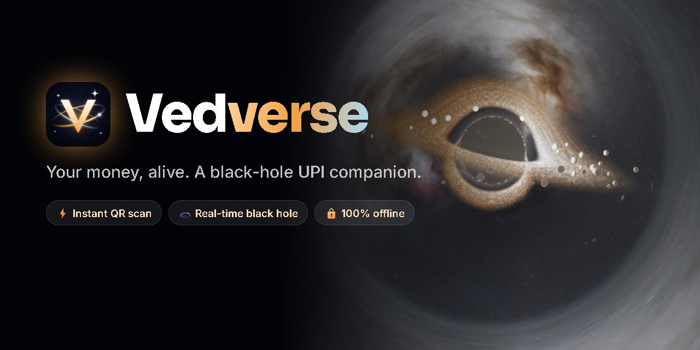
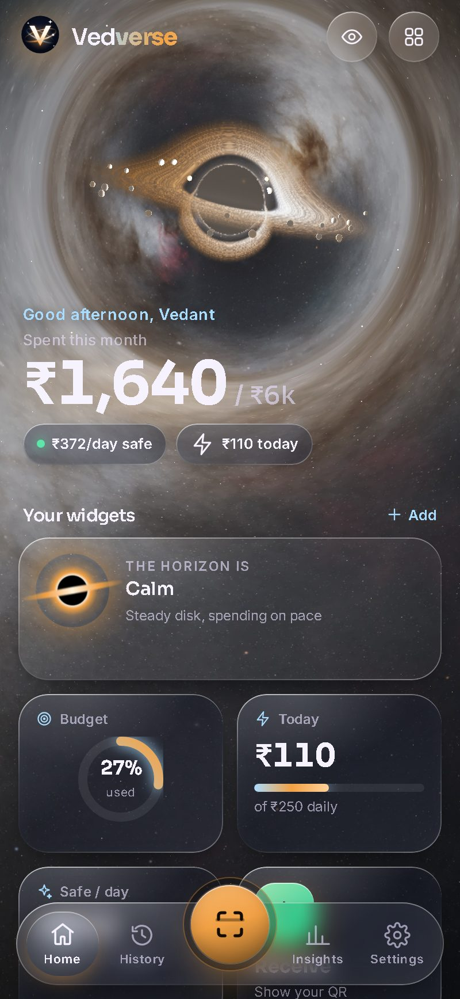
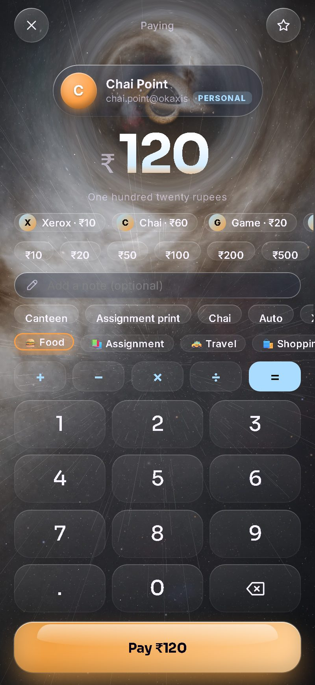
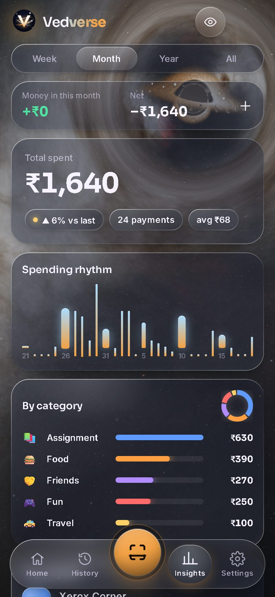
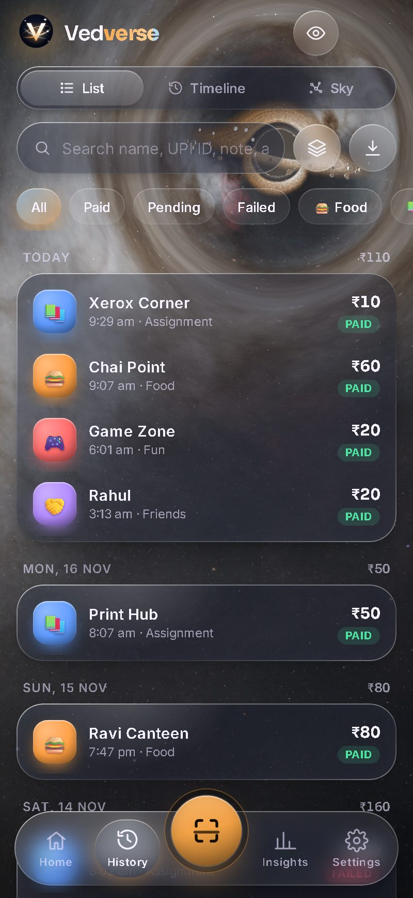
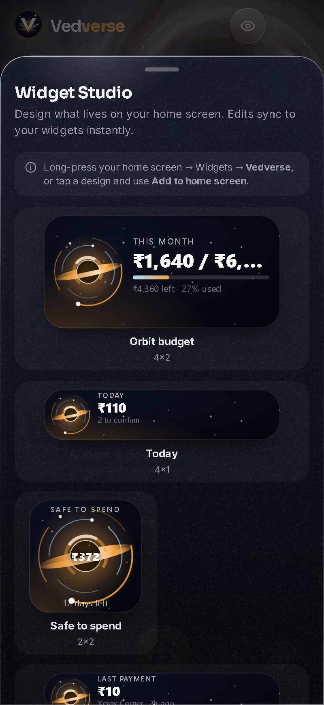
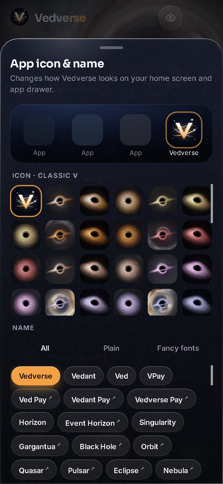
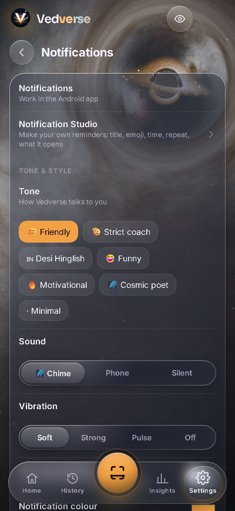
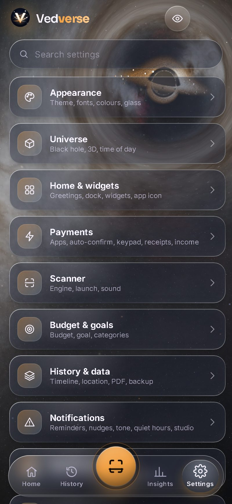

<div align="center">



# Vedverse

**A UPI payment companion with a real-time black hole at its heart.**
Scan any UPI QR in milliseconds, pay with the app you like, and watch your universe react to how you spend.

[](https://github.com/forpc1428-eng/vedverse/releases/latest/download/Vedverse.apk)
&nbsp;
[](https://github.com/forpc1428-eng/vedverse/releases/latest)


</div>

---

## 📸 Screens

<p align="center">
  
  
  
  
</p>
<p align="center">
  
  
  
  
</p>

---

## ⬇️ Install

1. On your Android phone, open **[Vedverse.apk](https://github.com/forpc1428-eng/vedverse/releases/latest/download/Vedverse.apk)**. That link always gets the newest version.
2. When Android asks, allow **Install unknown apps** for your browser or file manager (once).
3. If Play Protect says *"Unknown app"* or offers to scan it, tap **More details → Install anyway** (or **Scan app**). Android shows this for every app that isn't from the Play Store.
4. Open Vedverse. It asks once whether you'd like notifications. Saying no is fine.

**Updates** install straight over the old version and **keep all your data**, because every release is signed with the same key.

---

## ✨ Features

### 🕳️ A living universe
- **Ray-traced Schwarzschild black hole** rendered in real time: a photon ring, Einstein ring, lensed stars and a Doppler-beamed accretion disk on a baked **8K deep-sky panorama**.
- **Your black hole is your budget.** The disk glows calm when you're on track, heats up and flickers when you overspend, and payments become stars in your sky.
- 17 built-in themes plus a **theme builder**. Disk size, position, spin and brightness, and time-of-day colours that shift through the day.

### ⚡ Fastest QR scanner
- Native **CameraX + ML Kit** (model bundled, no download). It reads the **whole screen**, not a square.
- **Auto-zoom** on small or distant codes, **auto-focus** and **auto-flash** in the dark.
- Green corners snap onto the code the instant it's read.
- **Gallery**, **Paste** (copied UPI ID or link) and **type a UPI ID**. **Bharat QR (EMV)** support.
- A Quick Settings tile and a home-screen scan widget.

### 💸 Smart payments
- Pay with **GPay, PhonePe, Paytm, BHIM, CRED, Amazon Pay** and more. Ask every time or set a default.
- Calculator keypad (`120+45` pays ₹165), quick amounts and notes, recent payees, hold-to-pay for large amounts.
- Signed merchant QRs are sent untouched, and a **smart retry ladder** kicks in if an app declines.
- It **learns per app** whether pre-filled amounts are accepted (see the [FAQ](#-faq)).
- **Open UPI app separately** or on top of Vedverse: your choice.
- Receipts in **22 universe styles**, shareable as images.

### 📊 Track everything
- **Zero-lag black hole**: all 17 colours are pre-rendered with the real ray tracer and played as seamless video loops; the phone also re-renders each colour at its exact screen size while idle and keeps it forever.
- **Budget tracker mode** (big switch at the top of Settings): quick expenses, recurring expenses, spending calendar, movable widgets, and Home becomes a budget dashboard. Add cash, UPI or card expenses in one tap, set **category limits**, and see the month overview, forecast, savings goal and weekly chart.
- History with search and filters, a **timeline** of every scan and payment (with optional precise location), and a 3D **sky** view of your payees.
- **Insights**: spending rhythm, categories, forecast, money in vs out, and *Sound of your month*.
- Bills and reminders, split bills, a receive QR, a savings goal, and income tracking.
- **PDF statements** for any date range, made on the phone. JSON / CSV backup and restore.

### 🔔 Notifications, your way
- **Notification Studio**: your own reminders with emoji, time, repeat (once, daily, weekdays, weekly, monthly) and what tapping opens.
- **7 tones**: Friendly · Strict coach · Desi Hinglish · Funny · Motivational · Cosmic poet · Minimal.
- **Smart nudges**:
  - bills, with **Pay now / Mark paid / Snooze** buttons
  - over today's limit, a 3-day overspending streak, and no-spend-day celebrations
  - goal milestones and month-end summaries
  - payday and recurring-payment tips
  - *"Did it go through?"* with **Yes / No** buttons
- **Style and control**:
  - a bundled cosmic chime, vibration patterns and colour
  - rich notifications with a chart
  - quiet hours, a daily cap, and amounts hidden on the lock screen
  - an always-on quick bar (Scan · Receive · Pay)

### 🎨 Make it yours
- **26 animated home-screen widgets** (orbit rings, twinkling stars, sliding cards) plus **Widget Studio** to design your own, visually or as JSON, with photo backgrounds.
- **77 app icons** (36 ray-traced black holes and 41 unique designs) and **100 app names**, including fancy Unicode fonts. Both change on your actual home screen.
- Offline fonts, accent colour, glass level, dock editor, greetings, sound packs, haptic strength, animation speed, number formats and **10 languages**.
- Every feature has an on/off switch, and settings are searchable.

---

## 🔒 Privacy

- **No account, no server, no tracking.** Everything is stored only on your phone and works offline.
- Vedverse **never sees your bank details, UPI PIN or money**. Payments happen inside your own UPI app.
- **Permissions:**

| Permission | Why | Required? |
|---|---|---|
| Camera | Scanning QR codes | Only for the scanner |
| Notifications | Reminders and nudges you turn on | Optional |
| Location | Adding *where* to your timeline | Optional, off by default |
| Fingerprint / face | Unlocking the app | Optional |

Vedverse does **not** read SMS, other apps' notifications, contacts or files.

---

## ❓ FAQ

**Why doesn't GPay / BHIM show my amount when paying a person?**
Google Pay and BHIM refuse amounts that *another app* fills in for a **personal** UPI ID (a fraud-protection rule inside those apps), so no app can get around it. Vedverse opens them straight to the person and **copies the amount** for you to paste. Shop and merchant QRs work with the amount pre-filled. PhonePe and Paytm usually accept pre-filled amounts for people too.

**GPay shows "10.00" but I typed 10?**
That's the same ₹10. UPI apps always display two decimals.

**Is it on the Play Store?**
Not yet. Install the APK from [Releases](https://github.com/forpc1428-eng/vedverse/releases/latest).

---

## 🛠️ Build it yourself

Requirements: **Node 20+**, **JDK 21** and the **Android SDK** (`ANDROID_HOME` set).

```bash
npm install
npx cap add android            # first time only
node scripts/patch-android.mjs # injects the native layer (scanner, widgets, notifications…)
npx cap sync android
cd android && ./gradlew assembleRelease
```

**Signing:** release builds read the keystore path and passwords from environment variables (`VV_KEYSTORE`, `VV_STORE_PASS`, `VV_KEY_ALIAS`, `VV_KEY_PASS`) or from `keystore/signing.properties`. Both are git-ignored. Create your own keystore with `keytool -genkeypair -v -keystore keystore/vedverse-release.jks -alias vedverse -keyalg RSA -keysize 2048 -validity 10000`.

**Try it in a browser:** `npx http-server www -p 8080`, then open `http://localhost:8080/?demo=1`.

### Project layout
```
www/                  the app (HTML / CSS / JS, three.js and jsQR vendored, fully offline)
  js/app.js           screens, flows, settings
  js/universe.js      ray-traced black hole + sky (three.js)
  js/scanner.js       scanner engines     js/upi.js       smart UPI engine
  js/notify.js        notifications       js/extras.js    timeline, receipts, PDF, themes…
  js/homewidgets.js   home-screen widgets + Widget Studio
  assets/             baked sky, fonts, 77 app icons, chime
native/android/       Java plugins: UPI, scanner, widgets, notifications, QS tile
scripts/              Android patcher, sky / icon / chime bakers
```

---

<div align="center">
<sub>Made with ✦ by Vedant · Vedverse is not affiliated with NPCI, Google Pay, PhonePe, Paytm or any bank.</sub>
</div>
